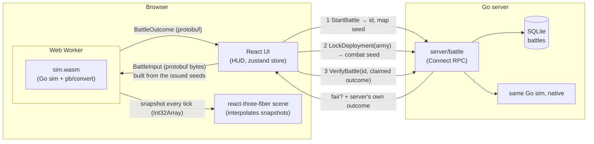

# Chill Autobattler

A web-based 3D auto-battler in the style of Warcraft III. You pick an army of 5, deploy it, and watch it fight on its own. Battles are chained into runs, and survivors become veterans with skills. The full design is in [`docs/GAME_CONCEPT.md`](docs/GAME_CONCEPT.md).

The main technical idea: the browser plays the battle, and afterwards the server proves it was fair. The battle rules are written once, in Go. They are compiled to WebAssembly for the browser and run natively on the server, and both produce bit-identical results for the same input.

## Quick start

You need Go 1.27+, Node 24+ and pnpm 11.

```bash
pnpm install
pnpm start      # builds sim.wasm, runs the Go server (:8080) and the web app (:5173); Ctrl-C stops both
```

Open http://localhost:5173.

Other commands:

```bash
pnpm gen        # protobuf → pb/ (Go) and web/src/gen/ (TypeScript)
pnpm server     # only the Go fairness server on :8080
pnpm dev        # only the web app (rebuilds sim.wasm first)
pnpm test       # Go tests natively and under WASM, TS typecheck
pnpm balance    # batch-simulate ~160k seeded battles → docs/balance-report.md (about 2.5 min)
```

### How to play

A **run** is a chain of matches. You keep playing while you keep winning, and the first loss ends it. Reloading the page resumes your run.

1. **Choose your army.** Pick 5 units from the warrior, archer and mage cards. Each card shows its stats and how much damage it takes from each class. Your last pick is remembered. Veterans from earlier matches are already in, shown in gold with their ★, and can't be dismissed.
2. **Deploy (15 s).** The server issues a battle and you see its map. Red is hidden under fog. Pick a formation from the bottom bar (the diagrams show your actual mix), or drag your units anywhere inside the blue zone. **Ready** starts early.
3. **Fight.** Your deployment is locked with the server, which only then reveals the combat seed. After a "Fight!" banner, the armies fight on their own.
   - **Fog of war:** you only see what your units see. The sight rules come from the sim, so rocks and trees block your view.
   - **Portraits** run along the bottom: yours on the left, Red's on the right, with "?" for enemies out of sight. Click one (or a unit) for its info panel, which shows status, kills, damage and skills.
   - The **minimap** (top right) shows the field under the same fog; click it to move the camera.
   - **Sound effects** are synthesized in the browser. The dev panel (top right) has mute, volume, and 1×/2×/4× speed.

   | Key | Does |
   |---|---|
   | WASD / arrows / screen edge | Pan the camera |
   | Mouse wheel | Zoom |
   | F | Follow the selected unit |
   | Space | Jump to the selected unit |
   | Double-click a portrait | Jump to that unit |
   | V | Toggle fog of war (debug) |
4. **Result.** Victory, Defeat or Draw, with survivors. The battle is verified with the server automatically.
   - **After a win:** +100 points, plus 10 per survivor. Every survivor becomes a veteran and learns one new skill of its class, up to 5. Then **Next match**. Red gets as many skills in total as your veterans have.
   - **After a loss or draw:** **Run over**, with the top-10 scoreboard (your runs highlighted) and **New run**.

## Architecture



### How a battle flows

1. **Start.** `StartBattle` creates a battle on the server with two fresh random seeds and stores it. The client gets the battle id and the **map seed**, which decides the map and Red's army, formation and skills. It does not get the **combat seed**, which decides every damage roll, crit, frost proc and cooldown jitter.
2. **Deploy.** The client builds a preview `BattleInput` (combat seed 0) to show the map and both armies, and the player rearranges Blue.
3. **Lock.** `LockDeployment` sends Blue's army. The server validates and stores it once, before the deploy deadline (2 min), and only then reveals the combat seed. The client can't test deployments against the real rolls.
4. **Play.** The Web Worker passes the bytes to `chillSim.create()` in the WASM build. It then calls `step(1)` every 50 ms, divided by the speed setting, and posts each snapshot to the main thread. The sim never sees the frame rate.
5. **Render.** The scene keeps the last two snapshots and interpolates between them every frame. Events in the snapshots (hits, skills, deaths) drive the floating numbers. The renderer only draws state; it never decides anything.
6. **Outcome.** When the battle ends, the worker returns a `BattleOutcome`: the result, tick count, survivors with their HP, and a checksum of the final state.
7. **Verify.** `VerifyBattle` sends only the battle id and the claimed outcome. The server rebuilds the input from what it stored (never from the client), re-runs it natively and answers fair only if the result, tick count and checksum all match. The first verdict is stored and final, and the deadline is 10 minutes after locking.

The server never drives a battle tick by tick. It only issues seeds, stores the army and re-runs finished battles, so a battle costs it about 3 ms of CPU and needs no live connection.

### Determinism: the core guarantee

Native Go and Go-in-WASM must agree to the bit, so the sim follows strict rules:

| Rule | Why |
|---|---|
| **Fixed-point maths only.** `sim.Fx` is Q48.16 in an `int64`; there are no floats in `sim/`. | Float results can differ between platforms and compilers (fused multiply-add, trig implementations). Integers can't. |
| **No trig.** Facing is a unit vector, flank cones are dot products against cos 60°, and turn steps and offset directions are precomputed tables. | Removes `math.Sin`/`Cos`, whose results differ by platform. |
| **A fixed 20 Hz tick.** All durations are tick counts. | Frame rate and the speed buttons can't change the outcome. |
| **Own RNG.** SplitMix64, with separate streams per purpose (`Sub(seed, StreamMap \| StreamRedArmy \| StreamCombat …)`). | `math/rand` helpers may change between Go versions, and separate streams mean adding a map feature doesn't shift combat rolls. |
| **Fixed update order.** Units are updated in a slice by index, ties go to the lower index, and Go maps are never iterated. | Go map iteration order is random. |
| **Versioned rules.** Every input carries `sim.Version`, and the server rejects versions it doesn't have. | Old replays must never be checked with new rules. |

These rules are enforced by tests:
- **Golden replays.** 18 recorded battles in `sim/testdata/golden.json` must replay exactly, both natively and under WASM. Updating the file without bumping `sim.Version` fails.
- **Lint test.** `TestNoNondeterministicImports` fails if `sim/` imports `math`, `math/rand`, `time`, `sync` or `os`, or uses floats, goroutines or map ranges.
- **Fuzz test.** `FuzzDeterminism` plays random inputs twice and requires identical outcomes.

### Anti-cheat model

| Attack | Defence |
|---|---|
| Claim a win that didn't happen | The server re-runs the stored battle; the result, ticks and checksum must match. |
| Re-roll the seed until a winning map turns up | Seeds come from the server (`crypto/rand`), and only issued battles can be verified. |
| Try many deployments against the real combat rolls | The combat seed is revealed only after the army is locked, once. |
| Change the army after seeing how the fight goes | The server verifies with the army it stored at lock time, not one the client sends. |
| Verify again until it passes | The first verdict is final. |
| Invalid armies (6 units, a skill twice, outside the zone) | Rejected at lock time by the same validation the sim uses. |
| Invent veterans, drop them, or weaken Red | The server stores the run's veterans. The army must lead with them exactly, and recruits have no skills. Red's skill count is computed from the veterans. |
| Close the tab when losing | A battle that misses its deadline counts as a loss, and the run ends. |
| Reload to undo a loss | Runs live on the server; a reload resumes the same run. |

Known limits: the client can read Red's army and the map, because the browser sim needs them, so fog of war is presentation only. A client can still search deployments against *estimated* rolls. Players are anonymous: a random token kept in localStorage, which the server stores only as a SHA-256 hash.

## Repository layout

```
sim/            Go: deterministic battle rules (no I/O, no dependencies outside the standard library)
  fixed.go        Fx fixed-point type, Vec, rotations
  data.go         all balance numbers: class stats, matchups, skills, constants, angle tables
  rng.go          SplitMix64 and derived streams
  mapgen.go       seeded obstacles (ponds, rocks, trees)
  grid.go         0.5 m nav grid: walkable, wet and opaque cells; line of sight and fire; push-out
  path.go         A* (integer costs, water ×1.43, stable ties) with string-pulling
  army.go         input types, validation, Red army generation, formation slots
  battle.go       Battle, Step, vision, end conditions, outcome and checksum, events
  unit.go         per-unit decisions: targeting, dash, blink, swing, kite, advance, movement
  combat.go       projectiles and the damage formula
  snapshot.go     Int32 snapshot encoding for the renderer
  testdata/       golden replays
pb/             Go module: code generated from proto/, plus pb/convert (wire ⇄ sim types)
wasm/           Go → WASM bridge: globalThis.chillSim.{create,map,step,outcome}
server/         Go Connect server
  auth/           anonymous player tokens (Bearer → player id; only hashes stored)
  run/            RunService: runs, veterans, skill picks, Red scaling, scores, scoreboard, abandonment
  battle/         StartBattle / LockDeployment / VerifyBattle for a run's matches (state machine, deadlines)
  store/          SQLite: migrations/*.sql (PRAGMA user_version), queries.sql → sqlc-generated Go
proto/          protobuf schema (chill.v1): BattleInput, BattleOutcome, BattleService
web/            Vite + React + react-three-fiber debug viewer
  src/sim/        Web Worker loop and snapshot decoder
  src/scene/      Arena, Units, Shots, Floats (R3F components)
  src/store.ts    zustand store: worker messages, interpolation state, Verify call
openspec/       specs and change proposals (spec-driven workflow)
docs/           game concept
tools/blender/  Blender script that bakes the unit models (from the prototype)
```

`go.work` ties the Go modules together. `sim` has no dependencies; `pb`, `wasm` and `server` depend on it via local `replace` directives.

## External libraries and tools

### Go

| Library | Used in | What for |
|---|---|---|
| Go standard library only | `sim/` | Deliberately dependency-free: `container/heap` for A*, `hash/fnv` for checksums, `errors`, `fmt` and `strconv`. |
| [`google.golang.org/protobuf`](https://pkg.go.dev/google.golang.org/protobuf) | `pb/`, `server/` | Protobuf runtime on the server. The browser build uses only its tiny `protowire` package through `pb/wire`, a hand-written decoder kept identical to `pb/convert` by an equivalence test. That keeps `sim.wasm` at 4.6 MB (1.3 MB gzipped), down from 8.0 MB. |
| [`connectrpc.com/connect/v2`](https://connectrpc.com) | `pb/`, `server/` | Connect RPC server. It speaks Connect, gRPC and gRPC-Web over plain `net/http`, and its handlers are generated from `proto/`. |
| [`modernc.org/sqlite`](https://pkg.go.dev/modernc.org/sqlite) | `server/store` | Pure-Go SQLite driver (no cgo) for issued battles. The file is `CHILL_DB`, default `server/chill.db`, in WAL mode. |
| [sqlc](https://sqlc.dev) (as a `go tool`) | `server/store` | Generates typed Go from `schema.sql` + `queries.sql`. Run `go generate ./server/store`; it's only used at generation time, not linked into the server. |
| `syscall/js` (std) | `wasm/` | Exposes Go functions to JavaScript. |

Pathfinding, steering, spatial queries and the RNG are written by hand in `sim/` rather than taken from libraries. Each is small, and owning them is what makes determinism and tie-breaking controllable.

### Web

| Library | What for |
|---|---|
| [React 19](https://react.dev) | UI and component model |
| [three.js](https://threejs.org) | WebGL rendering |
| [@react-three/fiber](https://r3f.docs.pmnd.rs) | three.js scenes written as React components (`<mesh>`, `useFrame`) |
| [@react-three/drei](https://drei.docs.pmnd.rs) | R3F helpers: `OrbitControls`, `Billboard` (health bars), `Html` (floating numbers) |
| [zustand](https://zustand.docs.pmnd.rs) | Small state store between the worker, HUD and scene. The scene reads it with `getState()` inside `useFrame`, so it doesn't re-render React every frame. |
| [@bufbuild/protobuf](https://github.com/bufbuild/protobuf-es) (protobuf-es v2) | Generated TypeScript types, and binary encode/decode of `BattleInput`/`BattleOutcome` |
| [@connectrpc/connect](https://connectrpc.com/docs/web/getting-started) + `connect-web` | Typed client for `BattleService` over HTTP |
| [Vite](https://vite.dev) + `@vitejs/plugin-react` | Dev server and bundler. In dev it proxies `/chill.v1.*` RPCs to the Go server on :8080. |
| [TypeScript](https://www.typescriptlang.org) | Type checking (`tsc -b`) |

### Tooling

| Tool | What for |
|---|---|
| [pnpm](https://pnpm.io) workspaces | JavaScript monorepo (`web/`, plus the root for buf) |
| [buf](https://buf.build) (npm `@bufbuild/buf`) | Protobuf lint, and code generation through remote plugins (protocolbuffers/go, connectrpc/go, bufbuild/es) as configured in `buf.gen.yaml` |
| [OpenSpec](https://github.com/Fission-AI/OpenSpec) | Spec-driven planning: specs in `openspec/specs/`, change proposals in `openspec/changes/` |
| Blender (headless Python) | Bakes the character models: `tools/blender/bake_units.py` |
| GitHub Actions | CI runs the same checks as `pnpm test` (added separately) |

### Assets

Characters and animations come from [Quaternius](https://quaternius.com)'s CC0 modular character and animation packs (thank you!). They are baked with Blender into 8 looks × Blue/Red:
- warriors: Mirko, Vesna, Radim;
- archers: Bogdan, Lada;
- mages: Zoran, Milena, Velimir, with purple robes and a hat.

| Path | What |
|---|---|
| `web/public/assets/units/` | The packed models: one shared geometry file per look, Blue/Red `.gltf`, and JPEG textures (about 17 MB). |
| `web/public/assets/clips.json` | The shared animations: idle, jog, sword attack, spell shot, hit, death, cheer. |
| `tools/blender/bake_units.py` | Re-bakes from the Quaternius source packs, which aren't in this repo (`QUATERNIUS_DIR`, default `../web3d-demo/assets/quaternius`): `blender --background --python tools/blender/bake_units.py`. |
| `tools/assets/pack_units.py` | Packs a bake for the web: shares Blue/Red geometry, converts PNGs to JPEG (macOS `sips`), and trims the clips. Run `python3 tools/assets/pack_units.py tools/blender/out`. |

The renderer drives each character's animation purely from the sim's snapshot flags (walking, attacking, staggered, dashing, dead). An attack animation is stretched to the sim's swing time, so the blow lands when the sim says it does. Rendering never feeds back into the battle.

## How we work

- **Spec first.** Larger changes start as an OpenSpec change: a proposal, delta specs, a design and tasks in `openspec/changes/<name>/`. They are implemented task by task, then archived into `openspec/specs/`. Project-wide constraints for agents are in `openspec/config.yaml`.
- **One PR per change.** Every change lands as a pull request.
- **Changing a rule** means changing `sim/data.go` or the logic, bumping `sim.Version`, then running `go test ./sim -run TestGoldenReplays -update` and reviewing the outcome changes in the diff.
- **Balance changes** come with numbers: run `pnpm balance` before and after, and show the difference in the PR. [`docs/balance-findings.md`](docs/balance-findings.md) explains the current numbers.
- **Changing the wire format** means editing `proto/chill/v1/battle.proto`, then running `pnpm gen && pnpm lint:proto`.
- **Changing the database** means adding a new numbered file in `server/store/migrations/` (never editing an applied one) and/or editing `queries.sql`, then running `go generate ./server/store`. `store.Open` applies the migrations above `PRAGMA user_version` at startup.
- **Snapshot layout** is defined in `sim/snapshot.go` and decoded in `web/src/sim/snapshot.ts`. Keep them in sync.
