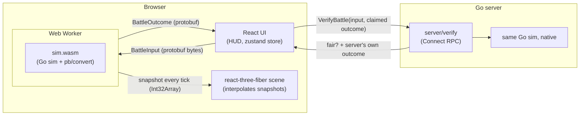

# Chill Autobattler

A web-based 3D auto-battler in the style of Warcraft III. You pick an army of 5, deploy it, and watch it fight on its own. Battles are chained into runs, and survivors become veterans with skills. The full design is in [`docs/GAME_CONCEPT.md`](docs/GAME_CONCEPT.md).

The main technical idea: the browser plays the battle, and afterwards the server proves it was fair. The battle rules are written once, in Go. They are compiled to WebAssembly for the browser and run natively on the server, and both produce bit-identical results for the same input.

## Quick start

You need Go 1.27+, Node 24+ and pnpm 11.

```bash
pnpm install
pnpm gen        # protobuf → pb/ (Go) and web/src/gen/ (TypeScript)
pnpm server     # Go fairness server on :8080
pnpm dev        # builds sim.wasm, then the web app on http://localhost:5173
pnpm test       # Go tests natively and under WASM, TS typecheck
```

In the debug viewer you pick a seed, Blue's classes and formation, and Red's skill count, then press **▶ Fight**. When the battle ends, **Verify on server** asks the server to re-run it.

## Architecture



### How a battle flows

1. **Input.** The UI builds a `BattleInput`: sim version, seed, Blue's units (class, skills, formation or positions) and Red's skill count. It is encoded as protobuf.
2. **Play.** The Web Worker passes the bytes to `chillSim.create()` in the WASM build. It then calls `step(1)` every 50 ms, divided by the speed setting, and posts each snapshot to the main thread. The sim never sees the frame rate.
3. **Render.** The scene keeps the last two snapshots and interpolates between them every frame. Events in the snapshots (hits, skills, deaths) drive the floating numbers. The renderer only draws state; it never decides anything.
4. **Outcome.** When the battle ends, the worker returns a `BattleOutcome`: the result, tick count, survivors with their HP, and a checksum of the final state.
5. **Verify.** The UI sends the input and its claimed outcome to `BattleService.VerifyBattle`. The server re-runs the input natively. It answers fair only if the result, tick count and checksum all match, and it always returns its own outcome.

The server never drives a battle tick by tick. It only re-runs finished battles, so a battle costs it about 3 ms of CPU and needs no live connection.

### Determinism: the core guarantee

Native Go and Go-in-WASM must agree to the bit, so the sim follows strict rules:

| Rule | Why |
|---|---|
| **Fixed-point maths only.** `sim.Fx` is Q48.16 in an `int64`; there are no floats in `sim/`. | Float results can differ between platforms and compilers (fused multiply-add, trig implementations). Integers can't. |
| **No trig.** Facing is a unit vector, flank cones are dot products against cos 60°, and turn steps and offset directions are precomputed tables. | Removes `math.Sin`/`Cos`, whose results differ by platform. |
| **A fixed 20 Hz tick.** All durations are tick counts. | Frame rate and the speed buttons can't change the outcome. |
| **Own RNG.** SplitMix64, with separate streams per purpose (`Sub(seed, StreamMap \| StreamRedArmy \| StreamCombat …)`). | `math/rand` helpers may change between Go versions, and separate streams mean adding a map feature doesn't shift combat rolls. |
| **Fixed update order.** Units are updated in a slice by index, ties go to the lower index, and Go maps are never iterated. | Go map iteration order is random. |
| **Versioned rules.** Every input carries `sim.Version`, and the server rejects versions it doesn't have. | Old replays must never be checked with new rules. |

These rules are enforced by tests:
- **Golden replays.** 18 recorded battles in `sim/testdata/golden.json` must replay exactly, both natively and under WASM. Updating the file without bumping `sim.Version` fails.
- **Lint test.** `TestNoNondeterministicImports` fails if `sim/` imports `math`, `math/rand`, `time`, `sync` or `os`, or uses floats, goroutines or map ranges.
- **Fuzz test.** `FuzzDeterminism` plays random inputs twice and requires identical outcomes.

### Anti-cheat model (current and planned)

- **Done:** the server re-runs every claimed battle, so a client can't fake a result or change an army after the fact. Invalid inputs (more than 5 units, a skill twice, a unit outside its zone, an unknown version) are rejected.
- **Next change:** the server issues the seed before the battle starts and records it. Without that, a client could simulate many seeds locally and submit only a good one.

## Repository layout

```
sim/            Go: deterministic battle rules (no I/O, no dependencies outside the standard library)
  fixed.go        Fx fixed-point type, Vec, rotations
  data.go         all balance numbers: class stats, matchups, skills, constants, angle tables
  rng.go          SplitMix64 and derived streams
  mapgen.go       seeded obstacles (ponds, rocks, trees)
  grid.go         0.5 m nav grid: walkable, wet and opaque cells; line of sight and fire; push-out
  path.go         A* (integer costs, water ×1.43, stable ties) with string-pulling
  army.go         input types, validation, Red army generation, formation slots
  battle.go       Battle, Step, vision, end conditions, outcome and checksum, events
  unit.go         per-unit decisions: targeting, dash, blink, swing, kite, advance, movement
  combat.go       projectiles and the damage formula
  snapshot.go     Int32 snapshot encoding for the renderer
  testdata/       golden replays
pb/             Go module: code generated from proto/, plus pb/convert (wire ⇄ sim types)
wasm/           Go → WASM bridge: globalThis.chillSim.{create,map,step,outcome}
server/         Go Connect server; server/verify re-runs and checks battles
proto/          protobuf schema (chill.v1): BattleInput, BattleOutcome, BattleService
web/            Vite + React + react-three-fiber debug viewer
  src/sim/        Web Worker loop and snapshot decoder
  src/scene/      Arena, Units, Shots, Floats (R3F components)
  src/store.ts    zustand store: worker messages, interpolation state, Verify call
openspec/       specs and change proposals (spec-driven workflow)
docs/           game concept
tools/blender/  Blender script that bakes the unit models (from the prototype)
```

`go.work` ties the Go modules together. `sim` has no dependencies; `pb`, `wasm` and `server` depend on it via local `replace` directives.

## External libraries and tools

### Go

| Library | Used in | What for |
|---|---|---|
| Go standard library only | `sim/` | Deliberately dependency-free: `container/heap` for A*, `hash/fnv` for checksums, `errors`, `fmt` and `strconv`. |
| [`google.golang.org/protobuf`](https://pkg.go.dev/google.golang.org/protobuf) | `pb/`, `wasm/`, `server/` | Protobuf runtime: decoding `BattleInput` and encoding `BattleOutcome`. Most of the size of `sim.wasm` (about 6.6 MB, 1.7 MB gzipped). |
| [`connectrpc.com/connect/v2`](https://connectrpc.com) | `pb/`, `server/` | Connect RPC server. It speaks Connect, gRPC and gRPC-Web over plain `net/http`, and its handlers are generated from `proto/`. |
| `syscall/js` (std) | `wasm/` | Exposes Go functions to JavaScript. |

Pathfinding, steering, spatial queries and the RNG are written by hand in `sim/` rather than taken from libraries. Each is small, and owning them is what makes determinism and tie-breaking controllable.

### Web

| Library | What for |
|---|---|
| [React 19](https://react.dev) | UI and component model |
| [three.js](https://threejs.org) | WebGL rendering |
| [@react-three/fiber](https://r3f.docs.pmnd.rs) | three.js scenes written as React components (`<mesh>`, `useFrame`) |
| [@react-three/drei](https://drei.docs.pmnd.rs) | R3F helpers: `OrbitControls`, `Billboard` (health bars), `Html` (floating numbers) |
| [zustand](https://zustand.docs.pmnd.rs) | Small state store between the worker, HUD and scene. The scene reads it with `getState()` inside `useFrame`, so it doesn't re-render React every frame. |
| [@bufbuild/protobuf](https://github.com/bufbuild/protobuf-es) (protobuf-es v2) | Generated TypeScript types, and binary encode/decode of `BattleInput`/`BattleOutcome` |
| [@connectrpc/connect](https://connectrpc.com/docs/web/getting-started) + `connect-web` | Typed client for `BattleService` over HTTP |
| [Vite](https://vite.dev) + `@vitejs/plugin-react` | Dev server and bundler. In dev it proxies `/chill.v1.*` RPCs to the Go server on :8080. |
| [TypeScript](https://www.typescriptlang.org) | Type checking (`tsc -b`) |

### Tooling

| Tool | What for |
|---|---|
| [pnpm](https://pnpm.io) workspaces | JavaScript monorepo (`web/`, plus the root for buf) |
| [buf](https://buf.build) (npm `@bufbuild/buf`) | Protobuf lint, and code generation through remote plugins (protocolbuffers/go, connectrpc/go, bufbuild/es) as configured in `buf.gen.yaml` |
| [OpenSpec](https://github.com/Fission-AI/OpenSpec) | Spec-driven planning: specs in `openspec/specs/`, change proposals in `openspec/changes/` |
| Blender (headless Python) | Bakes the character models: `tools/blender/bake_units.py` |
| GitHub Actions | CI runs the same checks as `pnpm test` (added separately) |

### Assets

Characters and animations come from [Quaternius](https://quaternius.com)'s CC0 modular character and animation packs, baked with Blender. They aren't in this repo yet; the debug viewer uses capsules.

## How we work

- **Spec first.** Larger changes start as an OpenSpec change: a proposal, delta specs, a design and tasks in `openspec/changes/<name>/`. They are implemented task by task, then archived into `openspec/specs/`. Project-wide constraints for agents are in `openspec/config.yaml`.
- **One PR per change.** Every change lands as a pull request.
- **Changing a rule** means changing `sim/data.go` or the logic, bumping `sim.Version`, then running `go test ./sim -run TestGoldenReplays -update` and reviewing the outcome changes in the diff.
- **Changing the wire format** means editing `proto/chill/v1/battle.proto`, then running `pnpm gen && pnpm lint:proto`.
- **Snapshot layout** is defined in `sim/snapshot.go` and decoded in `web/src/sim/snapshot.ts`. Keep them in sync.
